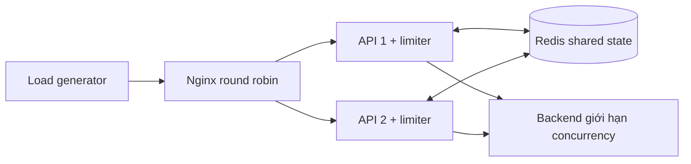

# Prototype và quyết định triển khai

Đây là thiết kế kỹ thuật của lượt triển khai được ủy quyền ngày 11/10/2026. Phạm vi nguồn vẫn theo [SOURCE_INDEX](context/SOURCE_INDEX.md); tham số dưới đây chỉ là mặc định pilot.

**Trạng thái hiện tại (20/10/2026):** T09 hoàn tất; protocol v1.2 cùng phụ lục một vị trí lượt dự kiến v1.3 đã được thực thi. T10 chưa bắt đầu, chưa có kết luận RQ và không được chạy thêm tải. Xem [kế hoạch việc còn lại](REMAINING_WORK_PLAN.md).

Roadmap vẽ lớp traffic control trước backend, Proposal gắn limiter vào API. Prototype chọn middleware ở đầu API, trước xử lý backend dùng chung. Local mode giữ map riêng từng tiến trình; Redis mode chia sẻ trạng thái. Backend là mẫu tải mô phỏng để giữ năng lực cố định khi thay số API instance.

## Policy

| Thành phần | Semantics |
| --- | --- |
| Identity | `X-Client-ID`, tối đa 256 bytes; định danh tin cậy do generator cung cấp, không phải cơ chế xác thực |
| Chi phí | 1 request = 1 đơn vị; không hoàn quota khi backend lỗi |
| Fixed Window | Cửa sổ epoch `[kW,(k+1)W)`; allow khi count < Q; reject không tăng count; reset ở biên |
| Token Bucket | Ban đầu đầy B; refill liên tục r/s, tối đa B; allow nếu tokens ≥ 1; reject không tiêu token |
| Precision | Milisecond; Redis TIME cho shared, wall clock tiến trình cho local; TB không refill lặp khi clock lùi |
| tính nguyên tử | Mutex bao trọn local decision; Lua bao trọn shared read/decide/write |
| TTL | FW hết hạn ở biên cửa sổ; TB không hết hạn sớm hơn thời gian refill đầy; local sweep cơ hội khi có request |
| Namespace | Redis key gồm namespace lượt chạy, fingerprint policy và hash client; không FLUSHDB |
| Quota exhausted | 429, Retry-After làm tròn lên giây |
| Redis unavailable | fail-closed: 503, không tới backend; fail-open: tiếp tục và gắn nhãn riêng |

Mặc định `Q=20,W=1s,B=20,r=20/s` cho cùng tốc độ dài hạn, không đồng nhất burst semantics. Không gọi TB nhận hơn Q trong một cửa sổ là overshoot FW. Kết quả được ghi theo thời điểm quyết định phía limiter; timestamp client không xác định thứ tự concurrent decisions.

## Tính đúng và giới hạn

Local nhiều instance cố ý không đảm bảo quota chung; đó là đối chứng RQ2/RQ3. Redis Lua giữ quyết định nguyên tử; script chạy trên Redis và có tính blocking theo [tài liệu Redis](https://redis.io/docs/latest/develop/programmability/eval-intro/). Thời gian shared lấy từ [Redis TIME](https://redis.io/docs/latest/commands/time/). Redis client tắt retry tự động để không lặp thao tác quota sau mất phản hồi; timeout vẫn có thể là kết quả không xác định (script đã chạy nhưng reply bị mất). Fail-open trong tình huống đó không chứng minh quota đúng.

Đối chứng không nguyên tử chỉ ở integration test, dùng barrier buộc các goroutine đọc cùng counter cũ. Nó minh họa lost update một cách tái lập, không đo tần suất race tự nhiên hay hiệu năng bản không nguyên tử.

Backend có semaphore không chờ và service time cấu hình. Arrival được đếm trước admission; overload trả 503. Counter phía backend là nguồn đúng cho arrivals; header phía client chỉ xác nhận arrivals khi nhận được phản hồi. HTTP transport error có thể xảy ra sau khi backend nhận request.

Định nghĩa và đối chiếu số đo backend/HTTP theo từng lượt được lưu trong [hồ sơ ma trận Console](worklog/2026-10-12-console-matrix/README.md). Bộ đo mới có 16.684 backend arrivals, 15.929 success, 755 overload; 762 phản hồi HTTP 5xx gồm overload và 7 fail-closed. Đây là số đo pilot ngày 12/10, không phải quy tắc tổng quát cho mọi loại lỗi.

Clock wall time vẫn có thể nhảy (đặc biệt FW). Môi trường thí nghiệm cần đồng hồ ổn định; local sweep O(số key), JSON/logging, goroutine scheduling và chung một host có thể ảnh hưởng độ trễ. Không suy kết quả thành production readiness.

## Các phép kiểm chứng

- Chuỗi tính tay cho FW boundary và TB refill/reject/idle; kiểm tra key độc lập, clock lùi, expiry và hủy context.
- Nhiều goroutine với local trạng thái: quota trong instance đúng nhưng cộng hai instance gấp đôi quota.
- Redis thật: nhiều đối tượng limiter dùng cùng namespace, nhóm theo thời điểm/window server; Token Bucket kiểm tra envelope B+rΔt.
- HTTP: reject không gọi backend; phân biệt fail-open/fail-closed, overload, transport failure.
- Smoke Compose: load balancer → 2 API → backend; lưu thô requests/config/summary/metrics và outage events.

Xem [hồ sơ từng bước](worklog/2026-10-11-bootstrap/README.md) để biết phép nào thực sự đã chạy. Các mục benchmark lặp, oracle đầy đủ trên trace, kiểm định generator và ngưỡng recovery mô tả công việc nghiên cứu tiếp theo trong hồ sơ ban đầu. Trạng thái hiện tại được ghi ở đầu tài liệu và trong [kế hoạch việc còn lại](REMAINING_WORK_PLAN.md).

## Bổ sung công cụ đo vòng 2

Đã có profile normal/burst/concurrent, topology 1/2/4 và [analyzer trace độc lập](experiments/ANALYSIS.md). [Hồ sơ vòng đo](worklog/2026-10-11-measurement/README.md) ghi pilot thực, các lượt generator không đạt tải và hiệu chỉnh. T09 đã hoàn tất theo protocol v1.2 cùng phụ lục v1.3; T10 chưa bắt đầu và chưa có kết luận RQ1–RQ5. Công cụ phân tích vẫn giữ trạng thái chưa đủ bằng chứng kết luận khi độ phủ cửa sổ/trạng thái không đủ.
