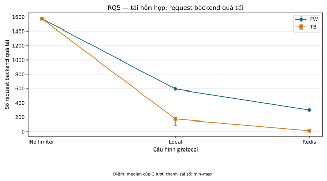
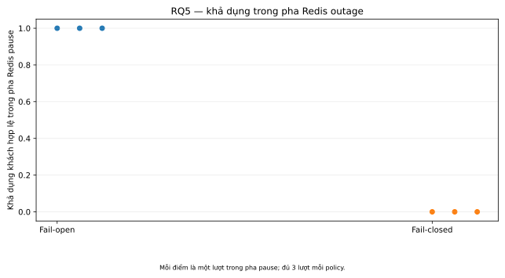
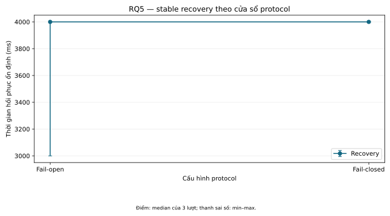

# Báo cáo Project 3 — bản nháp phần đã có căn cứ

> Bản nháp nghiên cứu có căn cứ, chưa phải bản nộp cuối. Phân tích offline T10 đã hoàn tất trên 138 lượt hợp lệ thuộc 46 cấu hình, ba lượt mỗi cấu hình. Kết quả áp dụng cho prototype và workload mô phỏng; rubric, ngày chính thức và phản hồi giảng viên chưa có. Trạng thái việc làm xem [kế hoạch còn lại](REMAINING_WORK_PLAN.md); các cổng đo xem [readiness](experiments/PROTOCOL_READINESS.md).

## 1. Bài toán doanh nghiệp

Xét một doanh nghiệp bán hàng trực tuyến phục vụ người mua qua API trong đợt flash sale. Load balancer phân phối request tới nhiều API instance, phía sau là backend dùng chung. Nhu cầu nghiên cứu là giữ lưu lượng theo từng client trong quota đã định, đồng thời dành năng lực xử lý cho người mua hợp lệ khi có client tạo tải đột biến.

Đây là tình huống giả định để nghiên cứu. Dự án không có log sự cố, số liệu doanh thu, hay SLO của một doanh nghiệp cụ thể; vì vậy các tác động dưới đây là rủi ro có thể xảy ra, không phải thiệt hại thực tế đã đo.

## 2. Khó khăn nghiệp vụ và tác động

Nếu mỗi API instance tự giữ bộ đếm, request của cùng client có thể được phân phối qua nhiều instance và tổng quota bị vượt. Chuyển bộ đếm sang Redis tạo shared state, nhưng chuỗi read–decide–write nếu không được thực hiện bằng atomic operation vẫn có thể cho phép nhiều request đồng thời vượt ngưỡng. Lưu lượng vượt kiểm soát có thể làm API hoặc backend/database chậm và lỗi, ảnh hưởng người mua hợp lệ và tạo rủi ro giao dịch không hoàn tất.

Do đó, chỉ báo số yêu cầu bị giới hạn chưa đủ để chứng minh lợi ích. Đánh giá cần xem đồng thời tính đúng quota, số request tới backend, khả năng phục vụ client hợp lệ và chi phí về độ trễ/tài nguyên.

## 3. Yêu cầu kỹ thuật và phạm vi

### Baseline dự án

- Mô phỏng nhiều API instance sau load balancer với local state và Redis shared state.
- So sánh Fixed Window và Token Bucket; kiểm tra tính đúng với concurrent requests và khi thay đổi số API instance.
- Dùng mixed workload gồm client hợp lệ và client tạo burst; so sánh không limiter, local rate limiter và Redis shared rate limiter trên cùng workload và năng lực backend.
- Thử ngắt Redis ngắn, có kiểm soát để đánh giá fail-open/fail-closed, quota violations, availability và recovery. Đây không phải kiểm thử production HA.
- Đo tính đúng khi allow/reject, quota violations/overshoot, độ trễ p50/p95/p99, thông lượng, CPU/bộ nhớ Redis; với mixed workload bổ sung goodput của client hợp lệ (số request hợp lệ được xử lý thành công mỗi giây), p95/p99 độ trễ của client hợp lệ, số request tới backend, 429, timeout/5xx. Với Redis outage bổ sung availability và recovery.

### Lựa chọn kỹ thuật của prototype

Roadmap minh họa một lớp kiểm soát lưu lượng trước backend; Proposal minh họa rate limiter gắn với API instance. Prototype hiện đặt rate limiter middleware ở đầu mỗi API instance, trước backend mô phỏng dùng chung. Đây là lựa chọn triển khai để khảo sát, không nhằm giải quyết khác biệt giữa hai tài liệu nguồn. Local state dùng mutex trong từng API instance; chế độ Redis dùng Lua để gộp quyết định quota thành một atomic operation, phù hợp với semantics script atomic và blocking do [Redis mô tả](https://redis.io/docs/latest/develop/programmability/eval-intro/). Backend dùng giới hạn yêu cầu xử lý đồng thời và thời gian xử lý cấu hình được để giữ năng lực ổn định giữa các lượt. Mã liên quan: [thiết kế và policy](IMPLEMENTATION.md), [limiter](../internal/limiter/limiter.go), [API handler](../internal/server/server.go).

`X-Client-ID` là mã định danh do bộ tạo tải đáng tin cậy cung cấp, không phải xác thực người dùng. Khi hết quota, API trả 429; lỗi rate limiter theo policy trả 503 ở fail-closed hoặc tiếp tục tới backend ở fail-open. Lỗi backend và quá tải được ghi riêng với lần từ chối hợp lệ của bộ giới hạn.

### Ngoài baseline

Sliding Window, dashboard/quản trị policy, Redis Cluster, gateway hoàn chỉnh, service mesh, Kubernetes/cloud production và hệ thống sẵn sàng cao không thuộc phạm vi cần để trả lời câu hỏi hiện tại. Có thể xem xét như hướng phát triển sau khi baseline được đánh giá.

### Cơ sở lý thuyết và công trình liên quan

**Token Bucket và burst.** RFC 3290, phụ lục A.2, mô tả traffic phù hợp bucket bằng cận `B + R × t` trong khoảng thời gian `t`. Project chuyển đơn vị từ lượng dữ liệu sang request, với chi phí mỗi request bằng 1; đây là lựa chọn mô hình của prototype. Cận này giải thích vì sao TB có thể nhận burst mà vẫn bị giới hạn theo tốc độ dài hạn. RFC thuộc loại Informational, không phải tiêu chuẩn bắt buộc cho API. [Bernet và cộng sự, 2002](https://www.rfc-editor.org/rfc/rfc3290.html#appendix-A.2)

**Fixed Window trong prototype.** Theo [policy triển khai](IMPLEMENTATION.md#policy), mỗi key được nhận tối đa Q request trong từng cửa sổ epoch dài W. Suy ra, nếu Q request đến ngay trước biên và Q request đến ngay sau biên, có thể nhận 2Q trong một khoảng ngắn cắt qua biên mà không vi phạm policy FW. Đây là ví dụ suy luận từ định nghĩa, không phải kết quả T09. Vì vậy, đặt `B=Q` và `r=Q/W` chỉ khớp tốc độ dài hạn mục tiêu; không đồng nhất burst semantics của FW và TB.

**Quota chung trên nhiều nơi xử lý.** Raghavan và cộng sự nghiên cứu các limiter phối hợp để áp một giới hạn băng thông toàn cục, với đánh đổi giữa chi phí trao đổi thông tin, độ chính xác và scaling. Công trình đặt nền cho câu hỏi local/shared state của dự án. Project 3 dùng Redis shared state cho quota request trên một host; không tái triển khai các thuật toán điều phối băng thông của bài báo hoặc so sánh trực tiếp số đo giữa hai hệ thống. [Raghavan và cộng sự, SIGCOMM 2007, mục 1–3](https://cseweb.ucsd.edu/~kvishwanath/papers/fp076-raghavan.pdf)

**Độ trễ ở phần đuôi phân phối.** Dean và Barroso chỉ ra biến thiên độ trễ có thể ảnh hưởng mạnh tới dịch vụ lớn, đặc biệt khi một request chờ nhiều thành phần. Điều này hỗ trợ việc quan sát p95/p99 bên cạnh thông lượng; không chứng minh limiter của Project 3 cải thiện độ trễ. Prototype không có topology fan-out của bài báo. RQ5 phải đọc latency của successful legitimate requests cùng goodput và lỗi, vì request thất bại không thuộc tập percentile đó. [Dean và Barroso, 2013, tr. 74–76](https://www.barroso.org/publications/TheTailAtScale.pdf)

Từ các cơ sở trên, đóng góp của Project 3 là bộ đối chứng thực nghiệm có thể truy nguyên cho FW/TB, local/Redis và backend protection trong testbed giới hạn. Lua là lựa chọn để thực hiện quyết định quota atomic; độ đúng của policy, hành vi outage và hiệu năng vẫn cần evidence riêng. Tài liệu bên ngoài giải thích khái niệm và cách đặt câu hỏi, không thay kết quả T06/T09/T10.

## 4. Giải pháp và mô hình thử nghiệm

Prototype gồm load generator, Nginx phân phối vòng tròn, hai API instance, Redis shared state và backend mô phỏng có giới hạn xử lý đồng thời. Chế độ `none` làm baseline; `local` và `redis` lần lượt biểu diễn local state của từng API instance và shared state. Hai thuật toán có cách hoạt động khác nhau: Fixed Window đặt lại quota ở ranh giới cửa sổ; Token Bucket cho phép tải đột biến tối đa theo dung lượng bucket và được nạp lại theo thời gian. Cấu hình pilot mặc định không làm cho hai thuật toán có cách xử lý tải đột biến tương đương.

T09 thu thập ma trận theo protocol v1.2 khóa; phụ lục v1.3 chỉ bổ sung slot còn thiếu đã được cho phép. Ma trận gồm normal, burst, mixed, topology một/nhiều API và Redis outage. T10 đối chiếu các cấu hình giữ cùng workload, policy, backend và môi trường theo từng contrast; dữ liệu truy nguyên được qua revision, manifest, run ID và artifacts. Bằng chứng concurrent requests cho RQ4 đến từ Redis tests của T06, không phải tải HTTP concurrent riêng. Xem [readiness](experiments/PROTOCOL_READINESS.md) và [hướng dẫn báo cáo số liệu](../scripts/README.md#xuất-báo-cáo-từ-artifact).

Phân biệt các nhóm số đo khi viết kết quả:

- **Tính đúng:** quyết định cho phép/từ chối so với oracle; quota violations/overshoot. `Inconclusive` do trace hoặc cửa sổ quan sát chưa đủ không được tính là đạt.
- **Hiệu năng:** thông lượng và độ trễ; p95/p99 được tính theo từng lượt rồi tóm tắt giữa các lượt, không gộp mẫu để tạo một percentile chung.
- **Bảo vệ backend và client hợp lệ:** số yêu cầu tới backend/quá tải, số request hợp lệ được xử lý thành công mỗi giây và độ trễ của client hợp lệ. 429 là từ chối do hết quota; 5xx có thể gồm quá tải hoặc fail-closed; timeout/lỗi truyền tải có thể không cho biết backend đã nhận yêu cầu hay chưa.
- **Redis outage:** khả năng phục vụ client hợp lệ, quota violations và phục hồi theo định nghĩa/cửa sổ đã chốt trước lượt đo. Chế độ fail-open có thể nhận yêu cầu khi không xác minh được quota; đây là đánh đổi về policy, tự nó không chứng minh có race condition.
- **Chất lượng lượt đo:** offered load/đã gửi/đã hoàn tất, request rơi, lỗi bộ giới hạn, clock discontinuity và sự khớp giữa trace, summary, metrics và cấu hình. Phải giữ lại lượt lỗi/không hợp lệ cùng lý do, không chỉ chọn lượt thuận lợi.

## 5. Thí nghiệm, kết quả và đánh giá

**Calibration lịch sử:** T04 hoàn tất 10 cấu hình normal/burst với một lượt mỗi cấu hình. T05 hoàn tất 27 cấu hình scaling hợp lệ, đồng thời lưu riêng một lượt lỗi do bộ tạo tải và ba lượt gián đoạn. T05 ghi nhận backend chung giới hạn khoảng 190 success/s ở offered 250 RPS; không suy ra khả năng mở rộng API hoặc chế độ nào tốt hơn. T07 hoàn tất calibration capacity10 có giới hạn: bốn ca healthy/outage gửi đủ 12.000 request, không rơi request, hai healthy gate đạt, recovery ổn định sau 4 giây theo tiêu chí cửa sổ 1s/min5/3 cửa sổ sạch; first success được báo riêng. Exporter smoke đánh dấu cả bốn ca dùng được sau một sửa lỗi null-resource riêng; revision đo gốc không đổi. Batch capacity4 quá tải/observer lỗi trước đó vẫn là bằng chứng sơ bộ, không ghép với cấu hình khác như cùng phép đo.

Các pilot trước đó gồm calibration dừng do clock discontinuity và ma trận 84 cấu hình có oracle mismatch, kết quả inconclusive, limiter errors hoặc generator drops; chúng không thay thế benchmark chính thức. Gate T01–T03 đạt ổn định trong phiên đo hiện tại và chất lượng sáu lượt pilot normal/mixed; độ chính xác UTC tuyệt đối và độ bền sau resume/restart chưa xác minh. Bằng chứng T06 là kiểm tra Redis thật: khi quota gần cạn, đúng hai đơn vị còn lại được chấp nhận ở cả Fixed Window và Token Bucket. Đối chứng non-atomic đồng bộ chủ động 16 reader để buộc lost update, tạo overshoot 15 khi quota là 1; đây là minh họa race có điều kiện, không đo tần suất tự nhiên. T06 không đo hiệu năng HTTP hay thông lượng Redis. Tài liệu [Redis Scripting with Lua](https://redis.io/docs/latest/develop/programmability/eval-intro/) xác nhận script chạy atomic và blocking; đây là semantics triển khai, còn kết quả T06 là evidence riêng trong test.

Các calibration và pilot trên là bằng chứng lịch sử, không gộp vào benchmark formal. Chi tiết gate T01–T03, calibration T04–T07, [readiness](experiments/PROTOCOL_READINESS.md), [checkpoint](context/SESSION_CHECKPOINT.md) và [pilot cũ](worklog/2026-10-13-calibration/README.md) được giữ để người đọc truy cứu.

T09 gồm 138/138 lượt được chấp nhận trên 46/46 cấu hình, mỗi cấu hình có ba lượt. T10 phân tích offline theo [protocol v1.2](experiments/protocol-v1.2/protocol.md) và [manifest khóa](experiments/protocol-v1.2/manifest.json); lượt bổ sung duy nhất tuân theo [phụ lục v1.3](experiments/protocol-v1.3/protocol.md). Số liệu liên tục được trình bày dạng median (min–max) của ba lượt; trong phần kết quả dưới đây dấu chấm là dấu thập phân và số đếm nguyên không có dấu phân nhóm. Goodput từng lượt = legitimate request thành công / `elapsed_seconds_including_drain`; latency lấy từ response thành công của legitimate request. p50/p95/p99 được tính riêng từng lượt rồi tổng hợp, nên median p95 không phải p95 gộp. Bảng đầy đủ, hình, run evidence, traceability và provenance nằm trong [T10_RESULTS](analysis/T10_RESULTS.md), [bảng T10](worklog/2026-10-20-t10/T10_TABLES.md), [hướng dẫn đọc](analysis/T10_RESULTS.md#cách-đọc-bảng-và-hình) và [worklog T10](worklog/2026-10-20-t10/README.md).

### Kết quả theo câu hỏi nghiên cứu

- **RQ1 — FW và TB:** Ở normal 20 RPS, các mode gần đạt 20 legitimate success/s. Trong một số workload mixed và burst, TB cho goodput/backend outcomes khác FW trong các cặp được đo. Đây là kết quả theo workload và cấu hình đã khóa; FW oracle vẫn **inconclusive**. Analyzer không thể xác lập đầy đủ khoảng quan sát trong miền giờ server, nên đánh dấu cửa sổ FW partial; thêm cửa sổ vào trace thụ động không tự làm oracle kết luận. Các test FW riêng vẫn là bằng chứng kiểm tra triển khai có phạm vi hẹp, không thay oracle HTTP. TB `no_violation_observed_within_trace` chỉ có nghĩa là không thấy vi phạm trong trace, không phải chứng minh tổng quát. Xem [bảng RQ1](worklog/2026-10-20-t10/T10_TABLES.md) và [hình latency p95](worklog/2026-10-20-t10/figures/rq1-latency.svg).
- **RQ2 — local và Redis:** Redis có p95 cao hơn local một lượng nhỏ ở normal trong máy đo này; không suy rộng sang workload khác. Mixed goodput median tăng từ 15.265 lên 17.597/s với FW và 18.546 lên 19.924/s với TB trong các cặp local→Redis. CPU Redis được đo theo core; memory là snapshot đầu/cuối. Network counters là tổng traffic Redis gồm workload, sampler, healthcheck và admin, không phải bytes/request riêng của limiter; outage không có resource sampling. Xem [bảng RQ2](worklog/2026-10-20-t10/T10_TABLES.md) và [hình CPU](worklog/2026-10-20-t10/figures/rq2-redis-cpu.svg)/[memory](worklog/2026-10-20-t10/figures/rq2-redis-memory.svg).
- **RQ3 — topology và tải:** Ở 50 và 180 RPS, goodput gần offered load. Ở 250 RPS, backend mô phỏng (capacity 10, service 50 ms) giới hạn goodput quanh 191/s; cell `scale-redis-fw-1api-250rps` có overload median 1772 (1768–1775) trên 7500 arrival mỗi lượt, theo [run evidence](worklog/2026-10-20-t10/run-evidence.csv) và [traceability](worklog/2026-10-20-t10/traceability.csv). Mức overload tương tự theo 1/2/4 API nên các cell 250 RPS không chứng minh khả năng scale API. Xem [bảng RQ3](worklog/2026-10-20-t10/T10_TABLES.md) và ba [hình scaling](analysis/T10_RESULTS.md#cách-đọc-bảng-và-hình).
- **RQ4 — atomicity/concurrency:** T06 kiểm tra Redis thật: khi quota còn hai đơn vị, 16 request đồng thời chỉ được phép đúng hai; đối chứng non-atomic ép overshoot 15. Tại thời điểm chạy, patch chưa commit và test dựa trên source revision `26b5decb835dbb136eb2d45b361920a414434f6b`; patch được commit sau tại `3e938a20925feef05c3608c05675c5149580a837`. Phần mô tả trong worklog và artifact manifest ghi hai SHA khác nhau; manifest khớp blob commit, nhưng không có source snapshot riêng trong artifacts để xác minh độc lập file đã chạy. Đây là bất nhất provenance, không phải bằng chứng test thất bại; chi tiết ở [T10 RQ4](analysis/T10_RESULTS.md#rq4--atomicityconcurrency-từ-t06) và [T06 evidence gốc](worklog/2026-10-19-atomicity/README.md). T06 không đo HTTP performance hay tần suất race tự nhiên.
- **RQ5 — bảo vệ backend và outage:** Các cell mixed được trình bày trong bảng 1 bên dưới. Các cell `outage-open-outage` (ba lượt; ID trong traceability) và `outage-closed-outage` (ba lượt; ID trong traceability) đo policy khi Redis pause. Đây là kết quả trong backend mô phỏng, không phải hiệu quả kinh doanh. Availability khi pause lần lượt là 1.000/0.000; stable recovery lần lượt 4000 (3000–4000) ms và 4000 (4000–4000) ms. First success là số đo riêng: 87.702 (69.940–91.747) ms open, 108.559 (107.118–140.044) ms closed. Stable recovery dùng cửa sổ 1000 ms, tối thiểu 5 mẫu/3 cửa sổ sạch; không đồng nhất hai metric. Fallback và overload dự kiến là outcome, không phải measurement fault.

#### Bảng 1. Tải hỗn hợp: goodput khách hợp lệ và backend overload

| Cell | Goodput (request/s), median (min–max) | Backend overload (request), median (min–max) |
|---|---:|---:|
| `mixed-none` | 7.822 (7.760–8.022) | 1575 (1572–1580) |
| `mixed-local-fw` | 15.265 (14.798–15.411) | 593 (591–595) |
| `mixed-local-tb` | 18.546 (15.644–19.312) | 174 (86–194) |
| `mixed-redis-fw` | 17.597 (17.464–17.864) | 300 (298–306) |
| `mixed-redis-tb` | 19.924 (19.891–19.924) | 12 (12–12) |

*Chú thích:* Tên cell khớp `traceability.csv`; ví dụ `mixed-none` gồm `p1-011-mixed-none-r1`, `p1-057-mixed-none-r2`, `p1-103-mixed-none-r3`. Mỗi cell có n=3 lượt. Goodput chia legitimate success cho `elapsed_seconds_including_drain`; overload là số request mỗi lượt. Dấu chấm là dấu thập phân theo bảng nguồn; số đếm nguyên viết không phân nhóm. Quan sát: các mode limiter đo được đồng thời có goodput cao hơn và overload thấp hơn `mixed-none` trong cấu hình này. Giới hạn: kết quả chỉ đại diện tải và backend mô phỏng đã khóa, không phải ước lượng lợi ích kinh doanh. Xem đủ ID từng cell trong [traceability](worklog/2026-10-20-t10/traceability.csv).

#### Hình 1. Backend overload trong tải mixed

*Chú thích:* Trục X là mode limiter; trục Y là backend overload (request). Mỗi cell có n=3 lượt; dấu giữa là median, thanh dọc min–max. Hình cho thấy overload của các mode limiter thấp hơn none trong workload này; không chứng minh khả năng khái quát sang backend thật. Hình SVG nguyên bản được lưu kèm T10 [checksum](worklog/2026-10-20-t10/SHA256SUMS).

#### Hình 2. Availability trong pha Redis pause

*Chú thích:* Trục X là fail-open/fail-closed; trục Y là availability (tỷ lệ legitimate request thành công, 0–1) chỉ trong pha pause. Hình vẽ ba điểm riêng cho mỗi policy (n=3), không vẽ median/min–max; các số tổng hợp bên cạnh là 1.000 (1.000–1.000) open và 0.000 (0.000–0.000) closed. Hình SVG nguyên bản được lưu kèm T10 [checksum](worklog/2026-10-20-t10/SHA256SUMS); các run ID nằm trong [traceability](worklog/2026-10-20-t10/traceability.csv).

#### Hình 3. Stable recovery sau Redis unpause

*Chú thích:* Trục X là policy; trục Y là stable recovery (ms), không phải first success. Mỗi policy có n=3 lượt, median và min–max. Fail-open là 4000 (3000–4000) ms; fail-closed là 4000 (4000–4000) ms theo tiêu chí 1000 ms/window, tối thiểu 5 mẫu và 3 cửa sổ sạch liên tiếp. Hình SVG nguyên bản được lưu kèm T10 [checksum](worklog/2026-10-20-t10/SHA256SUMS); các run ID nằm trong [traceability](worklog/2026-10-20-t10/traceability.csv).

Các số trên là mô tả thực nghiệm, không có kiểm định ý nghĩa thống kê. Valid measurement không đồng nghĩa correctness đã được chứng minh. Các nguồn số liệu được truy về manifest v1.2, các run/cell và artifacts trong [traceability](worklog/2026-10-20-t10/traceability.csv), [provenance](worklog/2026-10-20-t10/provenance.json) và [checksums](worklog/2026-10-20-t10/SHA256SUMS); revision đo là `0291a80fb404fea0eafee8c3431acc3631bb423e`. RQ4 là nguồn evidence T06 riêng như đã nêu.

### Giới hạn

FW correctness oracle còn inconclusive; Redis network là tổng traffic chứ không cô lập lưu lượng limiter; outage không có resource sampling. UTC accuracy tuyệt đối, độ bền restart/resume và khả năng khái quát từ backend mô phỏng chưa được xác minh. Kiểm tra atomicity ép race bằng barrier, không ước lượng tần suất race tự nhiên. Latency là median p95 theo run, không phải pooled p95. Stable recovery không phải first success. Tác động flash-sale vẫn là giả định nghiệp vụ; không có số liệu doanh thu hay SLO thực tế. Pilot/calibration lịch sử không thay thế kết quả formal T09/T10.

## 6. Kết luận tạm thời và hướng phát triển

Trong phạm vi prototype, kết quả mixed cho thấy các cấu hình limiter đo được giảm backend overload và tăng goodput khách hợp lệ so với none; kết quả 250 RPS bị giới hạn bởi backend mô phỏng, và FW correctness chưa được xác nhận. Các số này không xác lập lựa chọn phổ quát giữa thuật toán hoặc state mode.

Bản nháp đã bổ sung cơ sở lý thuyết và công trình liên quan; bước hoàn thiện là đối chiếu rubric/phản hồi khi được cung cấp và giữ rõ giới hạn correctness, outage, clock và backend. Sliding Window, dashboard hoặc nền tảng kiểm soát lưu lượng rộng hơn là tùy chọn sau baseline, không phải kết luận bắt buộc từ dữ liệu này.

## 7. Việc còn lại cho bản nộp

- Đối chiếu yêu cầu hình thức/rubric và phản hồi giảng viên khi được cung cấp; xác nhận ngày nộp/bảo vệ. Không suy đoán rubric hoặc ngày chính thức.
- Người học đọc các mục nguồn được dẫn trong phần cơ sở lý thuyết, tự giải thích liên hệ và giới hạn; H01 vẫn cần người học xác nhận. Hoàn thiện định dạng trích dẫn theo yêu cầu nộp.
- Đồng bộ báo cáo với slide/demo sau các phần việc được phép tiếp tục; xem [kế hoạch còn lại](REMAINING_WORK_PLAN.md).

## Tài liệu tham khảo

Các nguồn dưới đây đã được đối chiếu ở những mục được viện dẫn ngày 25/10/2026. Hai bài báo cung cấp bối cảnh nghiên cứu; RFC cung cấp mô hình Token Bucket; tài liệu Redis giải thích semantics triển khai. Không dùng số đo của các nguồn làm bằng chứng cho prototype.

1. Yoram Bernet, Steven Blake, Daniel Grossman và Andrew Smith. *An Informal Management Model for Diffserv Routers*. RFC 3290, Informational, tháng 5/2002, phụ lục A.2. [Bản RFC](https://www.rfc-editor.org/rfc/rfc3290.html#appendix-A.2).
2. Barath Raghavan, Kashi Vishwanath, Sriram Ramabhadran, Kenneth Yocum và Alex C. Snoeren. *Cloud Control with Distributed Rate Limiting*. ACM SIGCOMM, 2007, mục 1–3. [Bản tác giả](https://cseweb.ucsd.edu/~kvishwanath/papers/fp076-raghavan.pdf).
3. Jeffrey Dean và Luiz André Barroso. *The Tail at Scale*. Communications of the ACM, 56(2), 2013, tr. 74–80. DOI: `10.1145/2408776.2408794`. [Bản tác giả](https://www.barroso.org/publications/TheTailAtScale.pdf).
4. Redis. *Scripting with Lua*. Tài liệu chính thức, phần mở đầu về atomic/blocking execution. [Tài liệu](https://redis.io/docs/latest/develop/programmability/eval-intro/).

Định dạng danh mục còn chờ rubric; việc đối chiếu nguồn trong bản nháp không thay xác nhận kiến thức H01 của người học.
