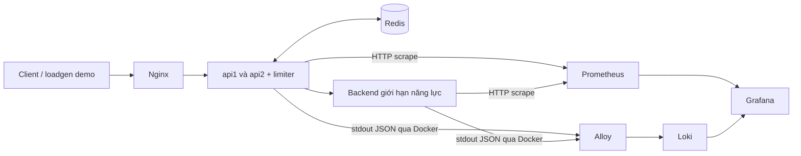

# Thiết kế monitoring giai đoạn 2

Thiết kế monitoring lập ngày 23/10/2026. P2-01/P2-02 đã triển khai metrics và overlay; P2-03 đã kiểm tra dashboard bảy panel và runtime G2 trên stack cố định. Ba scrape targets, JSON/exposition compatibility, datasource/dashboard provisioning, 11 PromQL expressions và UI đã được kiểm tra. Alloy/Loki chưa cấu hình. Console hiện có nút gửi một request mẫu qua ingress của stack cố định, nhưng **Chạy benchmark** vẫn dựng riêng `project3-research-lab` và không được scrape bởi dashboard. P2-03A đề xuất một luồng Console demo tải riêng; chưa triển khai/cấp quyền. `docker compose config` chỉ xác nhận cấu hình hợp nhất, không thay kiểm tra runtime. Task/gate ở [kế hoạch P2](PHASE2_PLAN.md); evidence P2-03 tại [G2 smoke](../../artifacts/monitoring/p2-03-g2/checks.md); baseline và protocol ở [kế hoạch chung](../REMAINING_WORK_PLAN.md) và [readiness](../experiments/PROTOCOL_READINESS.md).

## 1. Hai luồng dữ liệu



Mũi tên metrics mô tả hướng dữ liệu; **Prometheus chủ động scrape** API/backend. Alloy chỉ thu logs ở bản này. Grafana truy vấn hai datasource; không nằm trên đường xử lý request, không điều khiển policy/Redis. Không cần Pushgateway, tracing hoặc remote write.

Console có hai luồng tách biệt: **Chạy benchmark** gọi research runner trên `project3-research-lab`, không hiện trên dashboard cố định; **Gửi một request mẫu** gọi ingress `127.0.0.1:8080` của stack cố định và counters của request đó nằm trên ba target đã provision. Nút mẫu chưa phải load demo. P2-03A đề xuất luồng **Demo có giám sát** riêng dùng loadgen hiện có trên ingress cố định; xem trạng thái, phụ thuộc và cổng ở registry, không suy rằng đã hoạt động.

## 2. Điểm tích hợp

P2-01 xuất exposition từ atomic counters hiện có trong `internal/server/server.go`, không thêm dependency Prometheus. Giữ JSON `/metrics` cho `internal/console/console.go` và `scripts/research-pilot.sh`; metrics/health không tăng counter `/work`. Luồng Console request mẫu gửi vào ingress base; `/metrics` hiện cho biết mode/algorithm nhưng không đủ policy/topology. P2-03A phải lấy effective mode, algorithm, policy/quota và topology từ trạng thái runtime đã xác minh trước khi phát tải; giá trị form không phải bằng chứng. Focused server checks/vet và scrape runtime P2-03 đạt; Alloy/Loki còn chờ. Logs JSON từ `cmd/server/main.go` là nguồn pipeline dự kiến; không cần access log từng request.

## 3. Hợp đồng metrics đã triển khai trong P2-01

Endpoint: `GET /metrics/prometheus`; Prometheus text 0.0.4, `Content-Type: text/plain; version=0.0.4; charset=utf-8`, có `HELP`/`TYPE`, newline cuối, số không âm, **không gắn timestamp ứng dụng vào sample**. Prometheus lưu thời điểm scrape. Không thay số đo counter bằng rate phía app.

Labels app: `role`, `instance_id`; thêm `mode`, `algorithm` cho metrics API. Backend không mang policy labels không có ý nghĩa. Labels target do scrape config thêm: `job="project3-demo"`, còn `service` nhận một trong `api1`, `api2`, `backend`; `instance` là địa chỉ target do Prometheus quản lý, khác `instance_id` của app. Không dùng hai label cùng tên từ app và target.

Các giá trị từ config như `instance_id` phải escape `\\`, `"`, newline đúng định dạng, kể cả mặc định hiện tại đơn giản. Không đưa client ID, IP, request ID, namespace, run ID, timestamp hoặc error text thành metric label. Metadata lượt demo đặt trong artifact/annotation, tránh tạo series mới theo từng run.

Tất cả metrics bên dưới là **counter**, tích lũy từ lúc tiến trình start. API chỉ xuất nhóm API/limiter; backend chỉ xuất nhóm backend. Xuất cả giá trị 0 của nhóm đúng role để truy vấn ổn định.

| Metric | JSON / nguồn hiện tại | Ý nghĩa và giới hạn |
| --- | --- | --- |
| `project3_api_requests_total` | `requests` | Request vào `/work`, tăng trước validation; bao gồm 400 do ID sai |
| `project3_limiter_allowed_total` | `allowed` | Limiter quyết định allow; **mode none luôn 0**, không phải tổng request được proxy |
| `project3_limiter_rejected_total` | `rejected` | Quota denial trả 429; không gộp fail-closed hoặc 400 |
| `project3_limiter_errors_total` | `limiter_errors` | Lỗi Allow, loại trừ nhánh context client đã canceled trước quyết định fallback |
| `project3_limiter_fail_open_total` | `fail_open` | Lỗi limiter được cho đi tiếp; không chứng minh backend/client thành công |
| `project3_limiter_fail_closed_total` | `fail_closed` | Lỗi limiter trả 503, không gọi backend |
| `project3_api_backend_attempts_total` | `backend_attempts` | Tăng trước outbound request; có thể transport failure |
| `project3_api_backend_confirmed_arrivals_total` | `backend_confirmed_arrivals` | Phản hồi backend có arrival header true; **bao gồm overload** |
| `project3_api_backend_errors_total` | `backend_errors` | Lỗi tạo request, transport hoặc downstream 5xx; không gồm fail-closed 503 tại API |
| `project3_api_limiter_canceled_total` | `canceled` ở API | Chỉ nhánh hủy context trong xử lý lỗi limiter hiện tại, không phải mọi client cancellation |
| `project3_backend_arrivals_total` | `arrivals` | Backend nhận `/work` trước kiểm tra capacity; nguồn trực tiếp cho arrivals |
| `project3_backend_success_total` | `success` | Hoàn tất simulated service và trả 200; không bảo đảm client đã nhận phản hồi |
| `project3_backend_overload_total` | `overload` | Backend hết slot, trả 503 |
| `project3_backend_canceled_total` | `canceled` ở backend | Context hủy trong khi chờ simulated service |

Không có counter HTTP status đầy đủ, offered load, latency, goodput/client class, quota remaining tổng hợp hoặc Redis CPU/memory trong hợp đồng này. Không đổi semantics counters cũ để lấp chỗ thiếu. Đặc biệt không suy `requests = allowed + rejected` hay đẳng thức snapshot atomic giữa mọi counter.

Các target có thể `up=1` khi Redis lỗi hoặc API trả 503. `/healthz` là liveness, không phải kiểm tra shared-state dependency. Scrape `/metrics`, `/metrics/prometheus` và healthcheck không được tăng counters `/work`.

## 4. Scrape và dashboard

Khoảng scrape **2s**, timeout **1s**, refresh **5s**, rate window **20s**, dashboard **5 phút gần nhất** là cấu hình demo. Không đủ phân giải để kiểm tra FW 1s hay quota từng request.

Prometheus dùng DNS trong cùng Compose network, không `localhost` trong container:

| Target | Path |
| --- | --- |
| `api1:8080`, `api2:8080`, `backend:8080` | `/metrics/prometheus` |

Compose overlay dùng job `project3-demo`, label target `service` (`api1`, `api2`, `backend`) và scrape `/metrics/prometheus` qua DNS service nội bộ. Grafana datasource Prometheus đã provision với UID `project3-prometheus`; datasource Loki dự kiến UID `project3-loki`. Dashboard giữ UID `project3-monitoring-demo`; provider đặt dashboard vào folder **Project 3 Monitoring**, UID `project3-monitoring-folder`. Giữ UID dashboard và folder khác nhau: Grafana dashboard-list dùng UID để dò descendants, nên UID trùng giữa folder và dashboard tạo vòng lặp khi render lựa chọn trên cây. Dashboard có bảy panel: `up`, API requests/s, limiter quota reject/errors/fail-open/fail-closed, API backend attempts/s, backend arrivals và success/s, backend overload/s, API backend errors/s. `up=1` chỉ xác nhận scrape. Nhãn dashboard là **demo monitoring — dữ liệu minh họa mới**. Query giữ series thiếu là thiếu mẫu, không ép thành 0. Không dựng p95/p99, legitimate goodput hay correctness pass từ counter; dùng summary/trace/T10 riêng cho phía client.

PromQL mẫu bên dưới cũng là các query đã kiểm tra runtime ở G2:

```promql
sum by (service) (rate(project3_api_requests_total{job="project3-demo"}[20s]))
sum(rate(project3_limiter_rejected_total{job="project3-demo"}[20s]))
sum(rate(project3_backend_success_total{job="project3-demo"}[20s]))
sum(increase(project3_backend_overload_total{job="project3-demo"}[1m]))
up{job="project3-demo"}
```

Tính `rate` **trước** `sum` để xử lý reset từng instance. `increase` có extrapolation, không thay exact count; dưới hai sample là thiếu dữ liệu, không ép thành 0. Recreate tiến trình reset counter; backend không có mode label, nên dùng khoảng UTC riêng từng case, drain và tránh rate window cắt qua chuyển trạng thái. Không so cumulative totals qua reset hay thêm run ID label.

## 5. Hợp đồng logs

Pipeline dự kiến: Docker discovery **lọc project `project3-monitoring-demo` và service `api1`, `api2`, `backend`** → Alloy đọc stdout → Loki → Grafana. Redis/Nginx và logs nội bộ monitoring chưa thu ở bản đầu; có thể xem bằng Compose logs khi troubleshooting. Nếu đổi project name phải đổi filter tương ứng và chứng minh không thu ngoài scope.

Indexed labels tối thiểu: `project`, `service`; `role` nếu cần thì chỉ api/backend. Không dùng raw container ID/name có suffix, client/request ID, IP, timestamp, `error`, namespace/run ID. `level`, `msg`, `fail_policy` được parse tại query hoặc giữ trong JSON; không cần tăng số stream để lọc vài sự kiện.

Nguồn log app hiện có:

- `server started` với config: chứng minh startup/config, không chứng minh request thành công.
- `limiter unavailable`, `error`, `fail_policy`: cảnh báo có thể xuất hiện mỗi request lỗi; không mặc định có một log cho mỗi incident.
- `server stopped` khi lỗi: không bảo đảm shutdown bình thường luôn có log tương ứng.

Truy vấn dự kiến, cần đối chiếu payload thực tế ở P2-05:

```logql
{project="project3-monitoring-demo", service=~"api1|api2|backend"} | json
{project="project3-monitoring-demo", service=~"api1|api2"} | json | msg="limiter unavailable"
```

Log pipeline có buffering/độ trễ riêng; không dùng log count làm oracle exact request. Giữ timestamp nguồn nếu parser hỗ trợ đúng format đã quan sát; ghi timezone UTC của artifact và timezone dashboard, không sửa timestamp để làm khớp clock. Alloy cần state positions có ownership rõ; restart/replay/duplicate phải được quan sát, không hứa exactly-once.

## 6. Ranh giới vận hành

Overlay `compose.observability.yaml` merge với base bằng project `project3-monitoring-demo`; Compose base và Console research stack không đổi, research stack không tự được scrape. Prometheus `v3.15.0` và Grafana `12.4.11` được pin; UI chỉ bind loopback (`19090`, `13000`). Named volumes tách riêng theo project. Prometheus retention đặt 24h và 512MB block-size budget; WAL có thể làm volume dùng nhiều hơn con số retention size. Prometheus và Grafana có memory limit 512 MiB mỗi service; log rotation là 10 MiB × 3 file/service. Đây là ngân sách cấu hình, chưa đo thực tế. Grafana admin password đọc từ Compose secret file cục bộ; không commit credentials. Redis/Nginx và logs nội bộ không thuộc allowlist logs ban đầu. Chi tiết credentials, storage, cleanup và giới hạn file secret nằm trong [runbook](RUNBOOK.md); không mount socket vào Grafana/app hay expose daemon TCP. P2-03 runtime result và giới hạn hiện hành được ghi trong [sổ task P2](PHASE2_PLAN.md) và [checkpoint](../context/SESSION_CHECKPOINT.md).

## 7. Tham chiếu và trạng thái

Đối chiếu image [Prometheus `v3.15.0`](https://hub.docker.com/r/prom/prometheus/tags?name=v3.15.0) và [Grafana `12.4.11`](https://hub.docker.com/r/grafana/grafana/tags/); versioned sources gồm [Prometheus Dockerfile](https://github.com/prometheus/prometheus/blob/v3.15.0/Dockerfile), [Grafana Dockerfile](https://raw.githubusercontent.com/grafana/grafana/v12.4.11/Dockerfile) và [Grafana release](https://github.com/grafana/grafana/releases/tag/v12.4.11). Grafana Dockerfile cài `curl`; Prometheus image dùng BusyBox base cho healthcheck `wget`; Nginx Alpine image cũng dựa trên Alpine/BusyBox. Đây là đối chiếu source, không phải chạy executable trong image. Cấu hình đối chiếu [Prometheus scrape/retention](https://prometheus.io/docs/prometheus/latest/configuration/configuration/), [Prometheus storage/WAL](https://prometheus.io/docs/prometheus/latest/storage/) và [Grafana provisioning](https://grafana.com/docs/grafana/latest/administration/provisioning/). Tags được pin; actual image IDs/digests, Prometheus config validation bằng `promtool` trong pinned image, scrape/runtime và Grafana dashboard được ghi ở bằng chứng P2-03 G2. Pipeline tương lai dùng [Alloy Docker source](https://grafana.com/docs/alloy/latest/reference/components/loki/loki.source.docker/), [Loki labels](https://grafana.com/docs/loki/latest/get-started/labels/cardinality/), [Loki filesystem](https://grafana.com/docs/loki/latest/operations/storage/filesystem/) và [Loki retention](https://grafana.com/docs/loki/latest/operations/storage/retention/). Task/gate ở [kế hoạch P2](PHASE2_PLAN.md).
