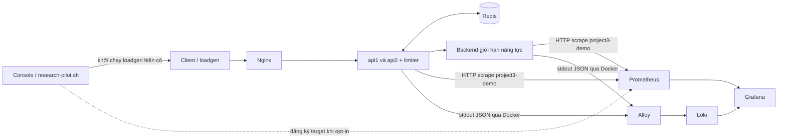

# Thiết kế monitoring giai đoạn 2

Thiết kế monitoring lập ngày 23/10/2026; trạng thái P2 cập nhật 24/10/2026. P2-01–P2-03 đã triển khai/kiểm tra exposition, overlay, dashboard bảy panel và ba fixed targets. **Chạy benchmark** hiện tạo case trong `project3-research-lab`, còn Prometheus chỉ scrape `project3-monitoring-demo`; vì vậy run đó chưa được Grafana quan sát. P2-03A đề xuất opt-in scrape cho chính run Console hiện có bằng file_sd + network allowlist; chưa triển khai/cấp quyền. Nút gửi request mẫu vẫn chỉ đi vào fixed stack. Task/gate ở [registry P2](PHASE2_PLAN.md), evidence cố định ở [G2 smoke](../../artifacts/monitoring/p2-03-g2/checks.md); baseline/protocol ở [kế hoạch chung](../REMAINING_WORK_PLAN.md) và [readiness](../experiments/PROTOCOL_READINESS.md).

## 1. Hai luồng dữ liệu



Mũi tên metrics mô tả hướng dữ liệu; **Prometheus chủ động scrape** API/backend. Đường chấm là đề xuất P2-03A: Console runner đăng ký target allowlist của case hiện tại, không đổi đường request hoặc generator. Alloy chỉ thu logs ở bản này. Grafana truy vấn hai datasource; không nằm trên đường xử lý request, không điều khiển policy/Redis. Không cần Pushgateway, tracing hoặc remote write.

Console có hai luồng hiện hữu: **Chạy benchmark** gọi runner trên `project3-research-lab`; **Gửi một request mẫu** gọi ingress `127.0.0.1:8080` của stack cố định. P2-03A giữ nguyên Chạy benchmark và chỉ đề xuất opt-in scrape target cho run hiện tại. Không tạo workflow/generator thứ hai. Xem registry để biết trạng thái và gate.

## 2. Điểm tích hợp

P2-01 xuất exposition từ atomic counters hiện có trong `internal/server/server.go`, không thêm dependency Prometheus. Giữ JSON `/metrics` cho `internal/console/console.go` và `scripts/research-pilot.sh`; metrics/health không tăng counter `/work`. Research runner đã resolve `compose-resolved.json`, policy, topology, image IDs và revision vào artifacts; P2-03A dùng chính case đó để xác định target allowlist và ghi cờ monitoring, không suy cấu hình từ giá trị form. `GET /api/runs/{id}/metrics` hiện poll counters trực tiếp qua Compose exec; Prometheus scrape mới là đường quan sát time series. Không đổi contract `/metrics` hoặc đổi source đo T09/T10. Logs JSON từ `cmd/server/main.go` là nguồn pipeline dự kiến; không cần access log từng request.

## 3. Hợp đồng metrics đã triển khai trong P2-01

Endpoint: `GET /metrics/prometheus`; Prometheus text 0.0.4, `Content-Type: text/plain; version=0.0.4; charset=utf-8`, có `HELP`/`TYPE`, newline cuối, số không âm, **không gắn timestamp ứng dụng vào sample**. Prometheus lưu thời điểm scrape. Không thay số đo counter bằng rate phía app.

Labels app: `role`, `instance_id`; thêm `mode`, `algorithm` cho metrics API. Backend không mang policy labels không có ý nghĩa. Job fixed hiện tại là `project3-demo`, target `service` thuộc `api1`, `api2`, `backend`. Đề xuất job thứ hai `project3-console-run`, target `service` thuộc `api1`…`api4`, `backend`; label `topology` nhận 1/2/4 và `project` giữ giá trị ổn định `project3-research-lab`. `instance` là alias scrape ổn định theo service, khác `instance_id` app. Không gắn Run ID, case, revision hay UTC vào labels; tránh high-cardinality và giữ chúng trong artifact/link.

Các giá trị từ config như `instance_id` phải escape `\\`, `"`, newline đúng định dạng, kể cả mặc định hiện tại đơn giản. Không đưa client ID, IP, request ID, namespace, run ID, timestamp hoặc error text thành metric label. Metadata lượt demo đặt trong artifact/annotation, tránh tạo series mới theo từng run.

Tất cả metrics bên dưới là **counter**, tích lũy từ lúc tiến trình start. API chỉ xuất nhóm API/limiter; backend chỉ xuất nhóm backend. Xuất cả giá trị 0 của nhóm đúng role để truy vấn ổn định.

| Metric | JSON / nguồn hiện tại | Ý nghĩa và giới hạn |
| --- | --- | --- |
| `project3_api_requests_total` | `requests` | Request vào `/work`, tăng trước validation; bao gồm 400 do ID sai |
| `project3_limiter_allowed_total` | `allowed` | Limiter quyết định allow; **mode none luôn 0**, không phải tổng request được proxy |
| `project3_limiter_rejected_total` | `rejected` | Quota denial trả 429; không gộp fail-closed hoặc 400 |
| `project3_limiter_errors_total` | `limiter_errors` | Lỗi Allow, loại trừ nhánh context client đã canceled trước quyết định fallback |
| `project3_limiter_fail_open_total` | `fail_open` | Lỗi limiter được cho đi tiếp; không chứng minh backend/client thành công |
| `project3_limiter_fail_closed_total` | `fail_closed` | Lỗi limiter trả 503, không gọi backend |
| `project3_api_backend_attempts_total` | `backend_attempts` | Tăng trước outbound request; có thể transport failure |
| `project3_api_backend_confirmed_arrivals_total` | `backend_confirmed_arrivals` | Phản hồi backend có arrival header true; **bao gồm overload** |
| `project3_api_backend_errors_total` | `backend_errors` | Lỗi tạo request, transport hoặc downstream 5xx; không gồm fail-closed 503 tại API |
| `project3_api_limiter_canceled_total` | `canceled` ở API | Chỉ nhánh hủy context trong xử lý lỗi limiter hiện tại, không phải mọi client cancellation |
| `project3_backend_arrivals_total` | `arrivals` | Backend nhận `/work` trước kiểm tra capacity; nguồn trực tiếp cho arrivals |
| `project3_backend_success_total` | `success` | Hoàn tất simulated service và trả 200; không bảo đảm client đã nhận phản hồi |
| `project3_backend_overload_total` | `overload` | Backend hết slot, trả 503 |
| `project3_backend_canceled_total` | `canceled` ở backend | Context hủy trong khi chờ simulated service |

Không có counter HTTP status đầy đủ, offered load, latency, goodput/client class, quota remaining tổng hợp hoặc Redis CPU/memory trong hợp đồng này. Không đổi semantics counters cũ để lấp chỗ thiếu. Đặc biệt không suy `requests = allowed + rejected` hay đẳng thức snapshot atomic giữa mọi counter.

Các target có thể `up=1` khi Redis lỗi hoặc API trả 503. `/healthz` là liveness, không phải kiểm tra shared-state dependency. Scrape `/metrics`, `/metrics/prometheus` và healthcheck không được tăng counters `/work`.

## 4. Scrape và dashboard

Fixed stack giữ scrape **2s**, timeout **1s**, refresh **5s**, rate window **20s**, dashboard **5 phút gần nhất**. Research scrape **1s**, `file_sd` refresh **1s**, rate window **4s** và lookback setup **4s** chỉ là ứng viên chưa runtime-validated. Nếu được cho phép, runner có thể chờ lookback trước load, không phát `/work`; ghi UTC setup/baseline riêng, rồi chạy đúng load duration yêu cầu và ghi final scrape sau drain. Link dùng load bounds chính xác, không shift để bỏ phần đầu tải. Case 3s có thể chỉ tạo vài samples; không đảm bảo rate ổn định hoặc tự đổi protocol/duration để thêm mẫu. G3 case tối đa **30s** dùng kiểm chứng timing; thiếu mẫu vẫn hiển thị thiếu/inconclusive, không suy quota correctness từ dashboard.

Prometheus dùng DNS trong cùng Compose network, không `localhost` trong container:

| Target | Path |
| --- | --- |
| `api1:8080`, `api2:8080`, `backend:8080` | `/metrics/prometheus` |

Compose overlay dùng `project3-demo` cho fixed service DNS. Đề xuất `file_sd_configs` allowlist với refresh interval ứng viên 1s, đọc target file do runner hiện tại tạo trong mounted ignored directory; shared network `project3-monitoring-scrape` chỉ nối Prometheus với API/backend case đang chạy, không Redis/Nginx. Monitoring Compose sở hữu network và volume mount; runner chỉ sở hữu manifest của lượt đang giữ lock. Runner ghi file sau healthy, đợi target UP/baseline scrape và một lookback phase riêng trước workload, giữ tới final scrape, rồi gỡ trước Compose cleanup. Lookback không tạo request và không kéo dài/đổi thời lượng workload. Không mount Docker socket vào Prometheus/Grafana và không discovery tùy tiện. Grafana datasource Prometheus giữ UID `project3-prometheus`; Loki dự kiến `project3-loki`. Dashboard giữ UID `project3-monitoring-demo`; folder giữ UID `project3-monitoring-folder`, khác nhau. Thêm job selector `project3-demo` / `project3-console-run` và link từ Console gồm selector cùng UTC load `from`/`to` chính xác; chỉ một job hiển thị mỗi lần. Các bảy panel hiện hành giữ nguyên semantics; `up=1` chỉ xác nhận scrape. Query thiếu mẫu không ép về 0. Không suy p95/p99, legitimate goodput hay correctness từ counters; dùng summary/trace riêng.

PromQL mẫu bên dưới cũng là các query đã kiểm tra runtime ở G2:

```promql
sum by (service) (rate(project3_api_requests_total{job="project3-demo"}[20s]))
sum(rate(project3_limiter_rejected_total{job="project3-demo"}[20s]))
sum(rate(project3_backend_success_total{job="project3-demo"}[20s]))
sum(increase(project3_backend_overload_total{job="project3-demo"}[1m]))
up{job="project3-demo"}
```

Tính `rate` **trước** `sum` để xử lý reset từng instance. `increase` có extrapolation, không thay exact count; dưới hai sample là thiếu dữ liệu, không ép thành 0. Recreate tiến trình reset counter; backend không có mode label, nên dùng khoảng UTC riêng từng case, drain và tránh rate window cắt qua chuyển trạng thái. Không so cumulative totals qua reset hay thêm run ID label.

## 5. Hợp đồng logs

Pipeline dự kiến: Docker discovery **lọc project `project3-monitoring-demo` và service `api1`, `api2`, `backend`** → Alloy đọc stdout → Loki → Grafana. Redis/Nginx và logs nội bộ monitoring chưa thu ở bản đầu; có thể xem bằng Compose logs khi troubleshooting. Nếu đổi project name phải đổi filter tương ứng và chứng minh không thu ngoài scope.

Indexed labels tối thiểu: `project`, `service`; `role` nếu cần thì chỉ api/backend. Không dùng raw container ID/name có suffix, client/request ID, IP, timestamp, `error`, namespace/run ID. `level`, `msg`, `fail_policy` được parse tại query hoặc giữ trong JSON; không cần tăng số stream để lọc vài sự kiện.

Nguồn log app hiện có:

- `server started` với config: chứng minh startup/config, không chứng minh request thành công.
- `limiter unavailable`, `error`, `fail_policy`: cảnh báo có thể xuất hiện mỗi request lỗi; không mặc định có một log cho mỗi incident.
- `server stopped` khi lỗi: không bảo đảm shutdown bình thường luôn có log tương ứng.

Truy vấn dự kiến, cần đối chiếu payload thực tế ở P2-05:

```logql
{project="project3-monitoring-demo", service=~"api1|api2|backend"} | json
{project="project3-monitoring-demo", service=~"api1|api2"} | json | msg="limiter unavailable"
```

Log pipeline có buffering/độ trễ riêng; không dùng log count làm oracle exact request. Giữ timestamp nguồn nếu parser hỗ trợ đúng format đã quan sát; ghi timezone UTC của artifact và timezone dashboard, không sửa timestamp để làm khớp clock. Alloy cần state positions có ownership rõ; restart/replay/duplicate phải được quan sát, không hứa exactly-once.

## 6. Ranh giới vận hành

Overlay `compose.observability.yaml` merge với base bằng project `project3-monitoring-demo`; P2-03A dự kiến chỉ gắn shared network vào Prometheus và các service API/backend allowlist của opt-in research case, không đổi base Compose hay traffic path. Prometheus `v3.15.0` và Grafana `12.4.11` được pin; UI chỉ bind loopback (`19090`, `13000`). Named volumes tách riêng theo project; TSDB giữ scrape samples trong retention 24h sau khi case kết thúc. Prometheus đặt 512MB block budget, nhưng WAL có thể làm volume dùng nhiều hơn; memory limit là 512 MiB/service; log rotation 10 MiB × 3/service. Đây là cấu hình, chưa đo thực tế. Grafana admin password đọc từ Compose secret file; không commit credentials. Không mount Docker socket vào Prometheus/Grafana hoặc expose daemon TCP. Chi tiết ownership/cleanup ở [runbook](RUNBOOK.md); trạng thái/evidence ở [sổ P2](PHASE2_PLAN.md) và [checkpoint](../context/SESSION_CHECKPOINT.md).

## 7. Tham chiếu và trạng thái

Đối chiếu image [Prometheus `v3.15.0`](https://hub.docker.com/r/prom/prometheus/tags?name=v3.15.0) và [Grafana `12.4.11`](https://hub.docker.com/r/grafana/grafana/tags/); versioned sources gồm [Prometheus Dockerfile](https://github.com/prometheus/prometheus/blob/v3.15.0/Dockerfile), [Grafana Dockerfile](https://raw.githubusercontent.com/grafana/grafana/v12.4.11/Dockerfile) và [Grafana release](https://github.com/grafana/grafana/releases/tag/v12.4.11). Cấu hình đối chiếu [Prometheus scrape/file SD](https://prometheus.io/docs/prometheus/latest/configuration/configuration/), [Prometheus file-based service discovery guide](https://prometheus.io/docs/guides/file-sd/), [Prometheus storage/WAL](https://prometheus.io/docs/prometheus/latest/storage/) và [Grafana provisioning](https://grafana.com/docs/grafana/latest/administration/provisioning/). `file_sd` cần refresh interval rõ để runner đăng ký target trước workload ngắn. Tags được pin; actual image IDs/digests, validator Prometheus, scrape/runtime và dashboard UI được ghi ở evidence P2-03 G2. Pipeline logs dùng [Alloy Docker source](https://grafana.com/docs/alloy/latest/reference/components/loki/loki.source.docker/), [Loki labels](https://grafana.com/docs/loki/latest/get-started/labels/cardinality/) và [Loki retention](https://grafana.com/docs/loki/latest/operations/storage/retention/). Task/gate ở [registry P2](PHASE2_PLAN.md).
