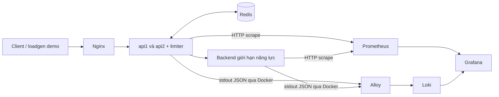

# Thiết kế monitoring giai đoạn 2

Đây là **hợp đồng triển khai dự kiến ngày 23/10/2026**, chưa phải stack đã hoạt động. Trạng thái và quyền thực hiện ở [kế hoạch P2](PHASE2_PLAN.md); giới hạn nghiên cứu ở [readiness](../experiments/PROTOCOL_READINESS.md). Nguồn mô tả hiện trạng là code đã khảo sát, không phải phép đo mới.

## 1. Hai luồng dữ liệu



Mũi tên metrics mô tả hướng dữ liệu; **Prometheus chủ động scrape** API/backend. Alloy chỉ thu logs ở bản này. Grafana truy vấn hai datasource; không nằm trên đường xử lý request, không điều khiển policy/Redis. Không cần Pushgateway, tracing hoặc remote write.

Giữ Console để đọc saved runs/artifact. Research runner của Console dùng `project3-research-lab` và Compose sinh theo case; không thuộc network/discovery của stack P2 cố định. Nếu sau này tích hợp runner, cần một gói thiết kế riêng.

## 2. Điểm tích hợp và tương thích

| Nơi | Hiện trạng | Hướng thay đổi giới hạn |
| --- | --- | --- |
| `internal/server/server.go` | Atomic counters; route JSON `/metrics` | Giữ nguyên; thêm `/metrics/prometheus` cùng nguồn counter |
| `internal/server/server_test.go` | Test quota, fail policy, timeout/cancel, metrics backend | Thêm focused coverage cho mapping/format/escaping và JSON compatibility |
| `internal/console/console.go` | Đọc JSON mặc định và qua Docker exec trong runner | Không đổi caller/schema để phục vụ Prometheus |
| `scripts/research-pilot.sh` | Lưu JSON before/after của API/backend | Không đổi hoặc mở lại protocol |
| `cmd/server/main.go` | JSON slog stdout, server-start config | Dùng lại; không thêm access log mọi request |
| `compose.yaml` | API1/API2/backend/Redis/Nginx | Dùng làm nền; monitoring trong file bổ sung |

Chưa có dependency Prometheus trong `go.mod`. Bản đầu ưu tiên xuất text từ các counter cố định bằng thư viện chuẩn, có escaping và focused checks. Không tạo registry/wrapper framework, exporter process hoặc instrumentation mọi handler cho nhu cầu này. Nếu chọn client library vì yêu cầu thực tế phát sinh, ghi tradeoff trong P2-01 và sửa hợp đồng trước khi thêm.

## 3. Hợp đồng metrics dự kiến

Endpoint: `GET /metrics/prometheus`; Prometheus text 0.0.4, `Content-Type: text/plain; version=0.0.4; charset=utf-8`, có `HELP`/`TYPE`, newline cuối, số không âm, **không gắn timestamp ứng dụng vào sample**. Prometheus lưu thời điểm scrape. Không thay số đo counter bằng rate phía app.

Labels app: `role`, `instance_id`; thêm `mode`, `algorithm` cho metrics API. Backend không mang policy labels không có ý nghĩa. Labels target do scrape config thêm: `job="project3-demo"`, còn `service` nhận một trong `api1`, `api2`, `backend`; `instance` là địa chỉ target do Prometheus quản lý, khác `instance_id` của app. Không dùng hai label cùng tên từ app và target.

Các giá trị từ config như `instance_id` phải escape `\\`, `"`, newline đúng định dạng, kể cả mặc định hiện tại đơn giản. Không đưa client ID, IP, request ID, namespace, run ID, timestamp hoặc error text thành metric label. Metadata lượt demo đặt trong artifact/annotation, tránh tạo series mới theo từng run.

Tất cả metrics bên dưới là **counter**, tích lũy từ lúc tiến trình start. API chỉ xuất nhóm API/limiter; backend chỉ xuất nhóm backend. Xuất cả giá trị 0 của nhóm đúng role để truy vấn ổn định.

| Metric dự kiến | JSON / nguồn hiện tại | Ý nghĩa và giới hạn |
| --- | --- | --- |
| `project3_api_requests_total` | `requests` | Request vào `/work`, tăng trước validation; bao gồm 400 do ID sai |
| `project3_limiter_allowed_total` | `allowed` | Limiter quyết định allow; **mode none luôn 0**, không phải tổng request được proxy |
| `project3_limiter_rejected_total` | `rejected` | Quota denial trả 429; không gộp fail-closed hoặc 400 |
| `project3_limiter_errors_total` | `limiter_errors` | Lỗi Allow, loại trừ nhánh context client đã canceled trước quyết định fallback |
| `project3_limiter_fail_open_total` | `fail_open` | Lỗi limiter được cho đi tiếp; không chứng minh backend/client thành công |
| `project3_limiter_fail_closed_total` | `fail_closed` | Lỗi limiter trả 503, không gọi backend |
| `project3_api_backend_attempts_total` | `backend_attempts` | Tăng trước outbound request; có thể transport failure |
| `project3_api_backend_confirmed_arrivals_total` | `backend_confirmed_arrivals` | Phản hồi backend có arrival header true; **bao gồm overload** |
| `project3_api_backend_errors_total` | `backend_errors` | Lỗi tạo request, transport hoặc downstream 5xx; không gồm fail-closed 503 tại API |
| `project3_api_limiter_canceled_total` | `canceled` ở API | Chỉ nhánh hủy context trong xử lý lỗi limiter hiện tại, không phải mọi client cancellation |
| `project3_backend_arrivals_total` | `arrivals` | Backend nhận `/work` trước kiểm tra capacity; nguồn trực tiếp cho arrivals |
| `project3_backend_success_total` | `success` | Hoàn tất simulated service và trả 200; không bảo đảm client đã nhận phản hồi |
| `project3_backend_overload_total` | `overload` | Backend hết slot, trả 503 |
| `project3_backend_canceled_total` | `canceled` ở backend | Context hủy trong khi chờ simulated service |

Không có counter HTTP status đầy đủ, offered load, latency, goodput/client class, quota remaining tổng hợp hoặc Redis CPU/memory trong hợp đồng này. Không đổi semantics counters cũ để lấp chỗ thiếu. Đặc biệt không suy `requests = allowed + rejected` hay đẳng thức snapshot atomic giữa mọi counter.

Các target có thể `up=1` khi Redis lỗi hoặc API trả 503. `/healthz` là liveness, không phải kiểm tra shared-state dependency. Scrape `/metrics`, `/metrics/prometheus` và healthcheck không được tăng counters `/work`.

## 4. Scrape, thời gian và dashboard

Giá trị khởi đầu đề xuất: scrape mỗi **2s**, timeout **1s**, refresh Grafana **5s**, rate window khoảng **20s**, dashboard mặc định **5 phút gần nhất**. Đây là cấu hình demo cần thử ở P2-03, không phải độ phân giải đủ kiểm chứng FW window 1s hoặc quota từng request. Nếu thay interval phải cập nhật datasource/query range tương ứng.

Prometheus static targets trên cùng Compose network:

| Service | Target | Path |
| --- | --- | --- |
| api1 | `api1:8080` | `/metrics/prometheus` |
| api2 | `api2:8080` | `/metrics/prometheus` |
| backend | `backend:8080` | `/metrics/prometheus` |

Không dùng `localhost:18081` từ container Prometheus; localhost ở đó là chính container. Không cần mở host port mới cho app hoặc dùng host networking.

Một dashboard, UID dự kiến `project3-monitoring-demo`, datasource UID `project3-prometheus` và `project3-loki`. Dashboard/provisioning lưu trong repo, được dựng lại tự động; không chỉ lưu các chỉnh sửa bằng tay trong database Grafana. Giao diện giải thích bằng tiếng Việt; tên fields/metric giữ nguyên.

| Panel | Nội dung | Cách hiểu |
| --- | --- | --- |
| 1 | `up` theo service | Scrape reachable; chưa kết luận dependency khỏe |
| 2 | API request/s theo instance | Thấy phân bố request, gồm cả request ID sai nếu có |
| 3 | Quota reject/s | Tách 429 hợp lệ khỏi lỗi |
| 4 | Lượt API thử gọi backend/s | Dùng được ở cả none/local/redis; không gọi là success |
| 5 | Backend arrivals/s, success/s và overload/s | Ba đường riêng, không cộng thành một “tổng” vì arrivals đã bao gồm các kết quả |
| 6 | Limiter errors/s, fail-open/s và fail-closed/s | Fail-open/closed là cách xử lý lỗi, không cộng với errors thành tổng lỗi |
| 7 | API backend errors/s | Nhóm lỗi tổng hợp có giới hạn status như bảng metrics |
| 8 | Logs app liên quan | Tạo khi Loki datasource có; Explore dùng để truy vấn chi tiết |

Tiêu đề chung phải có nhãn **demo monitoring — dữ liệu minh họa mới**. Không thêm panel p95/p99 từ counter, “legitimate goodput” từ backend success hoặc “correctness pass”. Dùng Console/summary/hình T10 riêng khi trình bày các chỉ số phía client.

Ví dụ PromQL để triển khai và giải thích, chưa được chạy trên stack:

```promql
sum by (service) (rate(project3_api_requests_total{job="project3-demo"}[20s]))
sum(rate(project3_limiter_rejected_total{job="project3-demo"}[20s]))
sum(rate(project3_backend_success_total{job="project3-demo"}[20s]))
sum(increase(project3_backend_overload_total{job="project3-demo"}[1m]))
up{job="project3-demo"}
```

Tính `rate` **trước** `sum` để xử lý reset từng instance. `increase` có extrapolation, có thể không nguyên; không dùng để thay count chính xác trong trace. Ít hơn hai sample thì rate không đủ dữ liệu; panel phải hiển thị thiếu mẫu, không ép thành 0 bằng truy vấn che lỗi.

Khi đổi mode, recreate tiến trình làm counters reset và labels API đổi series. Backend không có mode label: phải chọn **khoảng UTC riêng từng case**, tránh rate window cắt qua transition, để drain request cũ và xác nhận reset trước case mới. Không so cumulative totals từ hai tiến trình như một lượt liên tục. Không cần run ID label để giải quyết việc này.

## 5. Hợp đồng logs

Pipeline dự kiến: Docker discovery **lọc project `project3-monitoring-demo` và service `api1`, `api2`, `backend`** → Alloy đọc stdout → Loki → Grafana. Redis/Nginx và logs nội bộ monitoring chưa thu ở bản đầu; có thể xem bằng Compose logs khi troubleshooting. Nếu đổi project name phải đổi filter tương ứng và chứng minh không thu ngoài scope.

Indexed labels tối thiểu: `project`, `service`; `role` nếu cần thì chỉ api/backend. Không dùng raw container ID/name có suffix, client/request ID, IP, timestamp, `error`, namespace/run ID. `level`, `msg`, `fail_policy` được parse tại query hoặc giữ trong JSON; không cần tăng số stream để lọc vài sự kiện.

Nguồn log app hiện có:

- `server started` với config: chứng minh startup/config, không chứng minh request thành công.
- `limiter unavailable`, `error`, `fail_policy`: cảnh báo có thể xuất hiện mỗi request lỗi; không mặc định có một log cho mỗi incident.
- `server stopped` khi lỗi: không bảo đảm shutdown bình thường luôn có log tương ứng.

Truy vấn dự kiến, cần đối chiếu payload thực tế ở P2-05:

```logql
{project="project3-monitoring-demo", service=~"api1|api2|backend"} | json
{project="project3-monitoring-demo", service=~"api1|api2"} | json | msg="limiter unavailable"
```

Log pipeline có buffering/độ trễ riêng; không dùng log count làm oracle exact request. Giữ timestamp nguồn nếu parser hỗ trợ đúng format đã quan sát; ghi timezone UTC của artifact và timezone dashboard, không sửa timestamp để làm khớp clock. Alloy cần state positions có ownership rõ; restart/replay/duplicate phải được quan sát, không hứa exactly-once.

## 6. Vận hành có giới hạn

- `compose.observability.yaml` được merge cùng base Compose trong **một project**. Giữ `compose.yaml` chạy độc lập như trước; không gắn monitoring vào default quickstart hoặc research runner.
- Chỉ Grafana cần publish UI, đề xuất `127.0.0.1:3000`; Prometheus debug có thể `127.0.0.1:9090`. Loki dùng `http://loki:3100` nội bộ; Alloy không cần host port nếu không có nhu cầu debug. Phải kiểm tra xung đột cổng trước khi chọn.
- Pin image versions; cấu hình phải khớp version. Không giả định Loki sample từ branch main dùng được với image bất kỳ. Runtime ghi image identity thực tế, không coi tag là digest.
- Data riêng theo project; không bind TSDB/chunks vào vùng evidence cũ. Đề xuất Prometheus retention 24h kèm size budget; Loki local filesystem với retention tương thích version đã pin và theo dõi đĩa. Loki filesystem không tự xóa theo dung lượng trống; cần compactor/retention đúng hoặc cleanup dữ liệu demo đã chọn rõ.
- Quyết định con số storage/memory budget ở P2-02/P2-04 sau khi kiểm tra máy; chưa biết thì ghi chưa chốt. Giữ Docker logs có rotation, không chạy background vô hạn sau demo.
- Socket Docker, nếu chọn, chỉ mount vào Alloy; mount `:ro` không hạn chế các thao tác Docker API. Filter discovery giới hạn dữ liệu thu, không phải security boundary cho socket. Không expose API qua TCP hoặc mount socket vào Grafana/app.
- Grafana dùng credential local không commit; datasource truy cập nội bộ. Không xây auth platform hay mở stack ra internet.

## 7. Nguồn kỹ thuật và giới hạn xác minh

Tra tài liệu chính thức ngày 23/10/2026 qua web/Context7; không xác nhận image version hoặc khả năng chạy trên máy ở phiên này:

- [Prometheus exposition](https://prometheus.io/docs/instrumenting/exposition_formats/): định dạng counter, type và escaping.
- [Prometheus query functions](https://prometheus.io/docs/prometheus/latest/querying/functions/): rate, reset và increase.
- [Prometheus scrape configuration](https://prometheus.io/docs/prometheus/latest/configuration/configuration/): targets/labels/interval.
- [Grafana provisioning](https://grafana.com/docs/grafana/latest/administration/provisioning/): datasource/dashboard từ file.
- [Alloy Docker source](https://grafana.com/docs/alloy/latest/reference/components/loki/loki.source.docker/): Docker API, forwarding và positions.
- [Loki cardinality](https://grafana.com/docs/loki/latest/get-started/labels/cardinality/): labels và số stream.
- [Loki filesystem storage](https://grafana.com/docs/loki/latest/operations/storage/filesystem/), [retention](https://grafana.com/docs/loki/latest/operations/storage/retention/): đĩa và compactor.

Các cấu hình/metric names/UID/budgets trong tài liệu là thiết kế P2, chưa tồn tại trong sản phẩm. Ghi quyết định thực tế vào đúng phần khi triển khai; không biến thiết kế hoặc tài liệu vendor thành bằng chứng ứng dụng đã chạy đúng.
