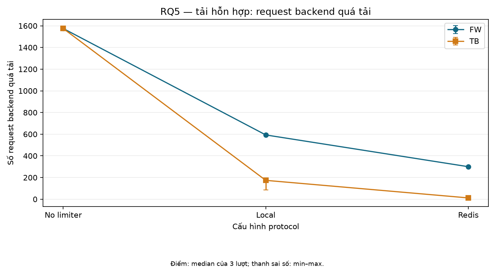
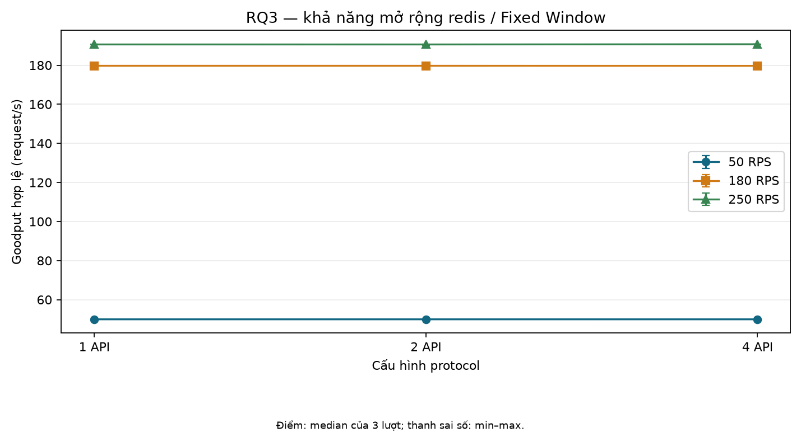
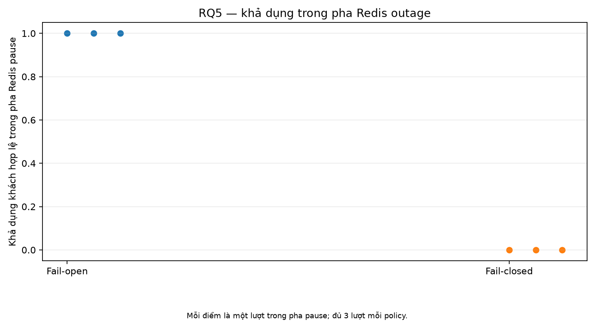
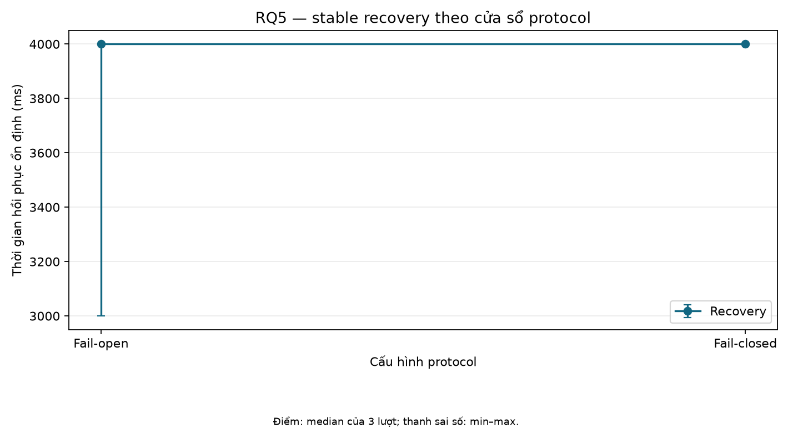

# Project 3 — nội dung nháp cho slide bảo vệ

> Bản nháp nội dung này được chuẩn bị từ [báo cáo](../REPORT_DRAFT.md). Template HUST đã nhận; yêu cầu nhập vào Canva bị chặn ở HTTP 429 trước khi có design ID. Chưa có deck PowerPoint. Nội dung sẵn sàng để áp dụng khi Canva khả dụng. Số liệu T10 chỉ áp dụng cho prototype/workload mô phỏng; mỗi cell có n=3 lượt và ghi median (min–max). Ngày chính thức, rubric, feedback và tài liệu học thuật cuối cùng đang chờ.

Trạng thái T13 và các việc hành chính ở [kế hoạch còn lại](../REMAINING_WORK_PLAN.md); T09/T10 evidence gates ở [readiness](../experiments/PROTOCOL_READINESS.md). Đây là nội dung slide, không phải deck đã hoàn tất.

## 1. Kiểm soát traffic API khi flash sale

- Project 3 nghiên cứu rate limiter phân tán trên nhiều API instance.
- Câu hỏi thực tế: làm sao giữ quota và dành năng lực backend cho client hợp lệ khi traffic tăng đột biến?
- Tình huống flash sale là giả định; không có doanh nghiệp, doanh thu hay SLO cụ thể được đo.

**Ghi chú nói:** Nêu pain point trước giải pháp. Tránh khẳng định thiệt hại kinh doanh đã xảy ra.

## 2. Từ pain point tới yêu cầu kỹ thuật

- Nếu mỗi API instance giữ counter riêng, cùng client có thể đi qua nhiều instance và dùng quota cộng dồn.
- Chia sẻ state giải quyết phối hợp giữa instance; read–decide–write không atomic vẫn có thể vượt quota khi request concurrent.
- Backend quá tải có thể làm chậm/lỗi API và ảnh hưởng request hợp lệ.
- Yêu cầu: kiểm tra correctness, backend overload, goodput/client hợp lệ, latency, scaling và hành vi khi Redis pause.

**Ghi chú nói:** Đây là yêu cầu dự án. Phân biệt chỉ số 429 với việc backend thực sự được bảo vệ.

## 3. Phạm vi và cách phân loại quyết định

- **Yêu cầu baseline:** nhiều API instance; local và Redis shared state; Fixed Window (FW) và Token Bucket (TB); mixed legitimate/abusive workload; bounded Redis outage fail-open/fail-closed.
- **Lựa chọn kỹ thuật:** middleware tại từng API; local mutex; Redis Lua atomic operation; backend mô phỏng có giới hạn concurrency.
- **Tùy chọn tương lai:** Sliding Window, dashboard, gateway đầy đủ, Redis Cluster, service mesh, production HA/cloud.

**Ghi chú nói:** Lua/middleware là quyết định triển khai prototype, không phải yêu cầu nguồn đã phân xử hay bằng chứng production.

## 4. Prototype và thiết kế đo

- Load generator → Nginx round-robin → 1/2/4 API instances (mỗi instance có limiter middleware) → backend mô phỏng dùng chung; Redis là shared state cho chế độ Redis.
- So sánh none/local/Redis và FW/TB dưới các workload normal, burst, mixed, scaling và outage.
- T09: 138/138 lượt hợp lệ, 46/46 cấu hình, ba lượt mỗi cấu hình; T10 phân tích offline theo protocol v1.2 và phụ lục v1.3 cho slot thiếu.
- Revision đo T09/T10: `0291a80fb404fea0eafee8c3431acc3631bb423e`.

**Ghi chú nói:** Mọi số liên tục là median (min–max) của đúng n=3 lượt, không phải confidence interval. p95/p99 tính riêng từng lượt rồi tổng hợp, không phải percentile từ trace gộp.

## 5. Mixed workload: client hợp lệ và backend

| Mode | Goodput client hợp lệ (request/s) | Backend overload (request) |
|---|---:|---:|
| none | 7.822 (7.760–8.022) | 1575 (1572–1580) |
| local FW | 15.265 (14.798–15.411) | 593 (591–595) |
| local TB | 18.546 (15.644–19.312) | 174 (86–194) |
| Redis FW | 17.597 (17.464–17.864) | 300 (298–306) |
| Redis TB | 19.924 (19.891–19.924) | 12 (12–12) |

**Ghi chú nói:** Trong workload và backend mô phỏng đã khóa, các limiter đo được có goodput cao hơn và overload thấp hơn none. Không suy rộng thành hiệu quả kinh doanh hoặc lợi thế phổ quát. Goodput = legitimate success / `elapsed_seconds_including_drain`.

## 6. Topology và giới hạn backend

- Ở offered load 50 và 180 RPS, goodput gần tải đưa vào.
- Ở 250 RPS, backend mô phỏng (capacity 10, service 50 ms) giới hạn goodput quanh 191/s.
- Cell `scale-redis-fw-1api-250rps`: overload median 1772 (1768–1775) trên 7500 arrival mỗi lượt.
- Kết quả 250 RPS tương tự theo 1/2/4 API; chưa chứng minh scaling của API.

**Ghi chú nói:** Đây là quan sát về bottleneck backend mô phỏng, không phải capacity của production.

## 7. Atomicity và concurrency (RQ4)

- T06 Redis thật: khi còn 2 quota, 16 request đồng thời chỉ được phép đúng 2 với cả FW và TB.
- Đối chứng non-atomic dùng barrier ép 16 reader cùng thấy counter 0 khi quota là 1; overshoot 15.
- Đây là invariant trong test và race bị ép có chủ đích, không phải tần suất race tự nhiên hay hiệu năng HTTP.
- **Trace riêng T06:** source revision `26b5decb835dbb136eb2d45b361920a414434f6b`; test SHA-256 `b51ef6d5c7c63dac5ae84e729911d4f7fc34cc761384c85674a56cff4d4ca46f`; patch test lúc đo chưa commit, không nằm trong revision đó.

**Ghi chú nói:** T06 evidence khác revision đo T09/T10. Không gộp hai nguồn thành một revision.

## 8. Redis outage: policy và recovery

- Availability trong pha pause: fail-open `1.000 (1.000–1.000)`; fail-closed `0.000 (0.000–0.000)`.
- Stable recovery sau unpause: open `4000 (3000–4000) ms`; closed `4000 (4000–4000) ms`.
- First success là metric riêng: open `87.702 (69.940–91.747) ms`; closed `108.559 (107.118–140.044) ms`.
- Recovery dùng cửa sổ 1000 ms, tối thiểu 5 mẫu, 3 cửa sổ sạch; outage không có resource sampling.

**Ghi chú nói:** Fallback/overload là outcome dự kiến. Đây là thí nghiệm bounded, không phải kiểm thử production HA.

## 9. Kết luận có giới hạn

- Trong mixed workload đã đo, limiter đi cùng goodput client hợp lệ cao hơn và backend overload thấp hơn none.
- Backend mô phỏng giới hạn kết quả ở 250 RPS; không kết luận API scale tuyến tính.
- FW correctness oracle còn **inconclusive**; TB không có observed violation trong trace không phải chứng minh tổng quát.
- Redis network counters là tổng traffic (workload, sampler, healthcheck, admin), không riêng limiter; outage không có resource samples.

**Ghi chú nói:** Hợp lệ về measurement không đồng nghĩa correctness đã được chứng minh. Không có kiểm định ý nghĩa thống kê.

## 10. Rủi ro diễn giải và hướng tiếp theo

- Backend mô phỏng; khái quát sang backend thật chưa được xác minh.
- UTC accuracy tuyệt đối và độ bền sau restart/resume chưa xác minh.
- T06 ép interleaving; không đo race tự nhiên hoặc throughput.
- Hướng cần làm: rubric/feedback/ngày chính thức, nguồn học thuật đã đọc, hoàn thiện báo cáo. Các mở rộng kỹ thuật vẫn tùy chọn.
- H01 (tự kiểm tra hiểu biết) và buổi tập dượt thật chưa hoàn tất.

**Ghi chú nói:** Kết thúc bằng phần còn thiếu có thể xử lý tiếp; không gọi đây là bản nộp cuối.

## 11. Demo và phương án ngoại tuyến

- Kịch bản demo khoảng 6 phút: [DEMO_SCRIPT.md](../DEMO_SCRIPT.md).
- Source snapshot, saved-run pilot UI và fallback T10: [setup và evidence T12](../DEMO_SCRIPT.md#source-và-phiên-bản).
- UI saved-run là pilot 13/10, không phải benchmark chính thức. Nếu Docker/UI lỗi, mở kết quả, bảng và hình T10; không cần internet.
- Không chạy workload trong phần trình bày.

**Ghi chú nói:** Demo UI chỉ minh họa artifact/runtime pilot; kết quả formal trình bày từ T10 artifacts.

## Phụ lục: truy nguyên

- Protocol/manifest: [v1.2](../experiments/protocol-v1.2/protocol.md), [manifest](../experiments/protocol-v1.2/manifest.json); slot bổ sung theo [v1.3](../experiments/protocol-v1.3/protocol.md).
- Kết quả và bảng đầy đủ: [T10_RESULTS](../analysis/T10_RESULTS.md), [T10 tables](../worklog/2026-10-20-t10/T10_TABLES.md).
- Run IDs/cell: [traceability.csv](../worklog/2026-10-20-t10/traceability.csv); provenance/checksum: [worklog T10](../worklog/2026-10-20-t10/README.md), [SHA256SUMS](../worklog/2026-10-20-t10/SHA256SUMS).
- T06 trace riêng: [worklog atomicity](../worklog/2026-10-19-atomicity/README.md).

## Checklist tập dượt

- [ ] Giải thích bằng lời sự khác nhau giữa yêu cầu baseline, lựa chọn kỹ thuật, và tùy chọn tương lai.
- [ ] Nói đúng median (min–max), n=3; nêu đây không phải confidence interval/kiểm định thống kê.
- [ ] Phân biệt goodput legitimate, 429, 5xx/timeout, overload backend.
- [ ] Giải thích tại sao 250 RPS chưa trả lời khả năng scale API.
- [ ] Nêu FW oracle `inconclusive`, total Redis traffic, outage thiếu sampling, và giới hạn backend mô phỏng.
- [ ] Trình bày T06 revision/hash/patch caveat riêng với T09/T10 revision.
- [ ] Demo fallback ngoại tuyến sẵn sàng; UI pilot được gọi đúng tên pilot.
- [ ] H01 và tự tập dượt: chờ người học thực hiện; không đánh dấu hoàn tất thay.

## Q&A gợi ý

| Câu hỏi | Điểm cần trả lời |
| --- | --- |
| Vì sao nhiều instance local có thể làm quota cộng dồn? | Mỗi instance giữ counter riêng, client được phân phối qua nhiều instance. |
| Lua bảo đảm điều gì? | Script quyết định quota như một atomic operation trên Redis; không tự chứng minh HA hay mọi tình huống production. |
| Vì sao FW correctness chưa kết luận? | Oracle/trace chưa cho phép kết luận; `inconclusive` không phải pass hay fail. |
| Goodput dùng mẫu số nào? | Legitimate success chia `elapsed_seconds_including_drain` cho từng lượt. |
| Vì sao mixed table không phải business ROI? | Workload và backend là mô phỏng, không có doanh thu/SLO/doanh nghiệp thật. |
| First success khác stable recovery thế nào? | Phản hồi thành công đầu tiên so với đạt các cửa sổ healthy liên tiếp theo tiêu chí đã khóa. |
| Bộ đếm network Redis có chỉ tính lưu lượng limiter không? | Không; counters tổng gồm workload, sampler, healthcheck và admin. |
| UI Console có phải kết quả formal không? | Không; saved runs là pilot 13/10, T10 artifacts là kết quả phân tích formal. |
