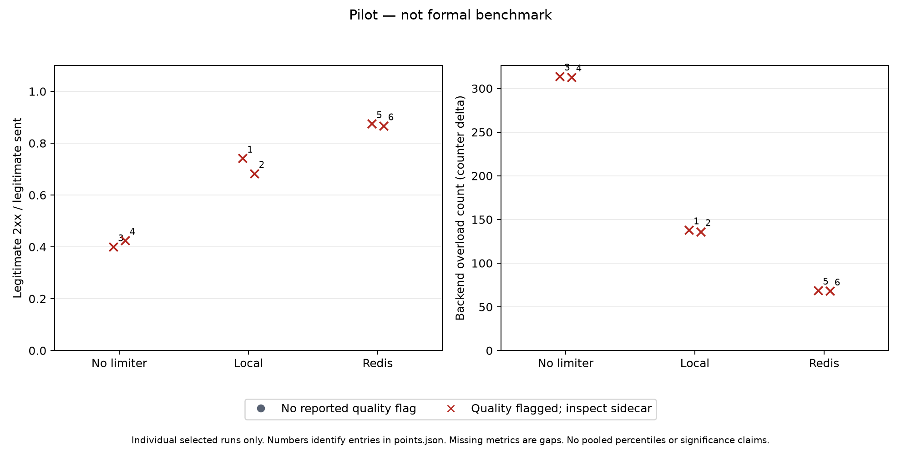

# Trình bày pilot và giới hạn kết luận — 13/10/2026

**Đây là kết quả pilot, không phải benchmark chính thức.** Gate clock đã thất bại; xem [điều kiện tiếp tục](../../experiments/PROTOCOL_READINESS.md). Không khóa protocol hoặc tự khẳng định mode thắng.

## Từ vấn đề đến thí nghiệm

Kịch bản flash sale giả định có traffic bất thường và nhiều API instances. Khi request vượt năng lực backend, người mua hợp lệ có thể mất khả năng hoàn tất yêu cầu. Prototype mô phỏng tác động bằng legitimate success/goodput, tail latency và backend overload; không đo doanh thu hay giao dịch doanh nghiệp thật. Yêu cầu kỹ thuật là quota chung, quyết định atomic và khả năng phục vụ client hợp lệ; giải pháp so sánh none/local/Redis với Fixed Window/Token Bucket.

[Calibration](../2026-10-13-calibration/README.md) dùng fresh state, tải normal/mixed/burst có cấu hình lưu từng lượt. Các bảng [CSV14 lượt](report/runs.csv) giữ cả invalid và quality flags; [cell summaries](report/cells.csv) từ chối aggregation khi fingerprint/evidence không đủ. Không tính p95 gộp hoặc chọn subset đẹp. [Manifest](manifest.json) chọn tường minh từng case; phải giải nén archive calibration vào repo root để tái tạo nếu raw artifacts đã dọn.

## Biểu đồ đo thật



[SVG](figures/calibration.svg), [manifest hình](plot-manifest.json), [points/quality](figures/points.json). Hình giữ **cả sáu lượt mixed** từ calibration: none/local/Redis mỗi mode hai lượt; mỗi điểm là một lượt, không đường fit hoặc suy ý nghĩa thống kê. Mọi điểm đều có quality flag, gồm dirty source metadata; một Redis lượt còn có clock/limiter error. Số điểm liên kết tới Run/cell trong sidecar; màu đỏ không đồng nghĩa tất cả request thất bại.

Observed legitimate success/sent: none48/120 và51/120, local89/120 và82/120, Redis105/120 và104/120. Backend overload tương ứng314/313,138/136,69/68. Đây là counts quan sát trong pilot có giới hạn; không dùng chúng làm số liệu kết luận cuối hoặc quy thành doanh thu. Trong bản tổng hợp bảo thủ, image manifest IDs khác hoặc dirty metadata làm cell không đủ cho aggregation chính thức.

## Bằng chứng cho từng RQ hiện tại

| RQ | Điều có thể nói / điều còn thiếu |
| --- | --- |
| 1 — Thuật toán | Có implementation/tests và sửa local TB under-admission; chưa có phép so FW/TB chính thức đủ lượt để kết luận performance/burst. |
| 2 — State | Trace/tests phân biệt quota riêng từng instance và shared state; global envelope local có thể vượt quota chung. Cần số liệu chính thức về overhead, không coi FW partial-window inconclusive là pass. |
| 3 — Scaling | Harness1/2/4 đã có; chưa có controlled load sweep và bottleneck evidence đủ để khẳng định scaling. |
| 4 — Atomicity | Redis Lua/concurrency và non-atomic control tests đạt với Redis thật; đây là kiểm chứng bất biến/test harness, không phải tần suất race hoặc performance production. |
| 5 — Bảo vệ/Redis lỗi | Mixed pilot tạo overload có kiểm soát và ghi outcomes hợp lệ; deadline mitigation có test/runtime evidence. Formal protection/outage/recovery vẫn thiếu vì clock gate và calibration chưa hoàn tất. |

## Tái tạo

```bash
tar -xzf docs/worklog/2026-10-13-calibration/evidence/calibration-artifacts.tar.gz
python3 scripts/report-study.py docs/worklog/2026-10-13-evaluation/manifest.json --output artifacts/report-recreated
python3 scripts/plot-calibration.py docs/worklog/2026-10-13-evaluation/plot-manifest.json --validate-only
# Dùng Python có Matplotlib, output phải chưa tồn tại:
python3 scripts/plot-calibration.py docs/worklog/2026-10-13-evaluation/plot-manifest.json --output artifacts/figures-recreated
```

Hình được render bằng Matplotlib 3.11.2 trong venv công cụ riêng ở `/tmp`, không thêm dependency cho Go/app. `runs-for-plot.json` là dữ liệu dẫn xuất từ CSV/JSON calibration cộng quality flags exporter; dữ liệu thô/archive không đổi. Exporter giữ lượt invalid và từ chối thống kê cell thiếu căn cứ. `clock_tolerance_ms=5` dùng để trình bày kiểm tra bảo thủ, không thay tiêu chí đã đặt trong pilot trước tải.

Hướng tiếp tục là ổn định môi trường, hoàn tất calibration/protocol và đo RQ1–RQ5, rồi báo cáo trade-off có bằng chứng. Sliding Window, dashboard quản trị và gateway/HA tiếp tục nằm ngoài công việc cần hoàn thành hiện tại.
